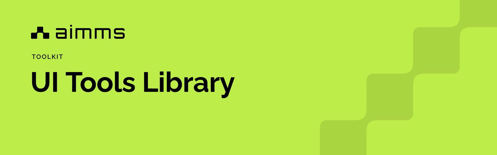

# UI Tools Library

This repository contains an aimms toolkit: **UI Tools Library**. It collects the findings of your data checks in a notification list for the WebUI, and reports progress in both WinUI and WebUI.

## What this toolkit solves

Applications often report findings one at a time, for example with a message dialog per
problem found in a data check. The user clicks through a series of dialogs, and the
information is gone once a dialog is closed. A WinUI application that is being converted
also needs a progress report that keeps working in both user interfaces.

This library collects findings with `uit::pr_addNotification` and shows them on the page
**NotificationHandling**, where the user marks them as handled and opens the related
pages. `uit::pr_DialogProgress` takes the same arguments as `DialogProgress` and reports
in WinUI or in the WebUI, depending on the flag `uit::bp_useWebUI`.

## How to use this toolkit

To get the most out of this toolkit, we highly recommend reading our detailed step-by-step guide on the aimms How-to website:

**[Read the full article: UI Tools Library](https://how-to.aimms.com/Articles/717/717-ui-tools-library.html)**

### Prerequisites

- **aimms:** you will need aimms installed to run the model. [Download the free Academic Edition here](https://www.aimms.com/support/licensing/).
- **WebUI:** this toolkit runs in the aimms WebUI, for a modern, browser-based experience.
- **A project to add it to::** this toolkit is a library, meant to be imported into an application of your own.

## Getting started

1. **Download the release:** go to the [Releases](https://github.com/aimms/ui-tools-library/releases) page and download the `.zip` file from the latest version.
2. **Open the project:** launch the `.aimms` file.
3. **Add the library:** in your own project, use **File > Library Manager > Add Library from Disk**.
4. **Use it:** report findings with `uit::pr_addNotification`, start each check with `uit::pr_clearNotifications`, and replace `DialogProgress(` by `uit::pr_DialogProgress(`.

## Support and feedback

This toolkit is maintained by the **aimms User Support Team**.

- Found an issue? [Open an issue](https://github.com/aimms/ui-tools-library/issues).
- Questions? Reach out via the [aimms Community](https://community.aimms.com).

---

Maintained by the aimms User Support Team. We optimize the way you build optimization.
